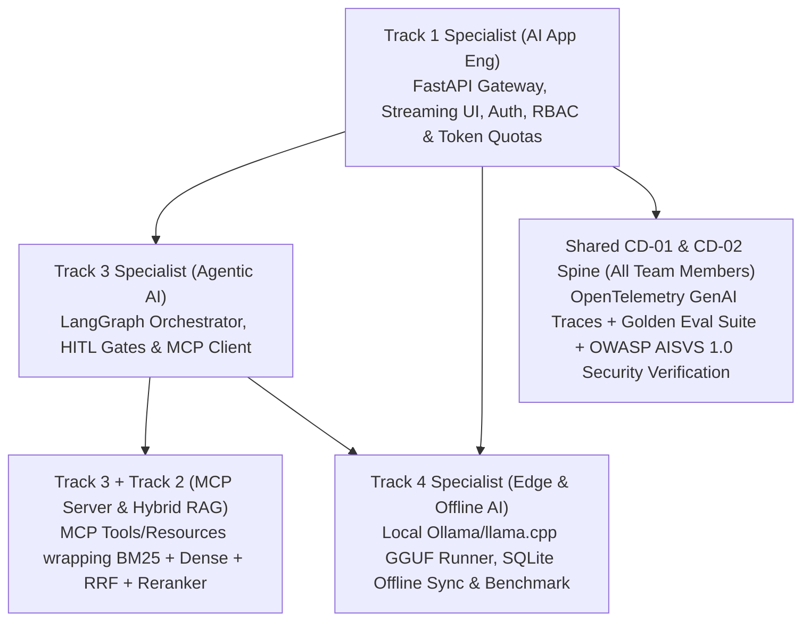

# STAGE 5 MASTER TEACHING PLAN, WEEKS 11–14 INTEGRATION & CAPSTONE LESSON PLANS, AND WORKLOAD VALIDATION
## Asabiyyah Technologies Global Applied AI Engineering Masterclass

| Field | Value |
|---|---|
| Document ID | ASB-FAC-001 |
| Version | 0.1 Draft |
| Status | Draft – pending management review |
| Owner (role) | Programme Director & Lead Instructional Designer (TBC) |
| Last updated | 2026-11-16 |
| Parent document | [MASTER_PROGRAMME_BLUEPRINT.md](../MASTER_PROGRAMME_BLUEPRINT.md) §§10–17 |
| Related decisions | AD-01, AD-02, CD-01–05, PD-03–05, GD-01–02 |
| Stage of origin | Stage 5 |

> **Governance & Single-Source Integration (GD-02b):**
> - Weekly syllabi and instructor lesson plans for **Weeks 1–4 (Common Core)** are maintained in [Common_Core_Curriculum_and_Syllabus.md](../02_COMMON_CORE/Common_Core_Curriculum_and_Syllabus.md).
> - Separate 6-week specialist lesson plans for **Weeks 5–10** (where each learner studies **one** chosen track) are maintained in:
>   - [Track 1: AI Application Engineering](../03_SPECIALISATION_TRACKS/AI_APPLICATION_ENGINEERING/Track_1_AI_Application_Engineering_Curriculum_and_Lesson_Plans.md)
>   - [Track 2: RAG & Knowledge Engineering](../03_SPECIALISATION_TRACKS/RAG_KNOWLEDGE_ENGINEERING/Track_2_RAG_Knowledge_Engineering_Curriculum_and_Lesson_Plans.md)
>   - [Track 3: Agentic AI Engineering](../03_SPECIALISATION_TRACKS/AGENTIC_AI_ENGINEERING/Track_3_Agentic_AI_Engineering_Curriculum_and_Lesson_Plans.md)
>   - [Track 4: Edge & Offline AI Engineering](../03_SPECIALISATION_TRACKS/EDGE_OFFLINE_AI_ENGINEERING/Track_4_Edge_Offline_AI_Engineering_Curriculum_and_Lesson_Plans.md)
> - This document provides: (1) the complete **Weeks 11–14 Integration, Production & Capstone Lesson Plans**, (2) the **14-Week Master Assignment & Assessment Calendar**, (3) the **Instructor Preparation & Low-Bandwidth Delivery Checklist**, and (4) the **Programme Workload Validation Report**.

---

## 1. Weeks 11–14 Weekly Syllabus and Instructor Lesson Plans (Cross-Functional Product Teams)

In Week 11, learners transition from single-track mentor pods (6–7 learners) into **5 Cross-Functional Product Teams of ~10 learners** (each team combining 2–3 specialists from Track 1 Application, Track 2 RAG, Track 3 Agentic/MCP, and Track 4 Edge/Offline) (PD-05, PR-04).

### Architecture of a Cross-Functional Capstone Product

---

### WEEK 11: Cross-Functional System Architecture, Interface Contracts & Capstone Kickoff (Integration Phase)

- **Estimated Time:** 13.5 hours (`4.0 h` Live | `3.0 h` Guided Lab | `2.0 h` Independent | `4.5 h` Project)
- **Learning Objectives:**
  1. Decompose a real-world Nigerian/global industry problem into modular subsystem contracts connecting Application/UI (Track 1), Hybrid RAG (Track 2), MCP Agentic Tools (Track 3), and Local/Offline Inference & Sync (Track 4) (`CC-03`, `CC-05`, `CC-09`).
  2. Define immutable `Pydantic v2` API schemas and `MCP` tool/resource contracts so all 4 specialist sub-teams develop in parallel without integration deadlocks (`CC-01`, `SC-*`).
  3. Construct the team's **v1 Golden Evaluation Dataset ($\ge 30$ end-to-end test cases)** and baseline OpenTelemetry trace pipeline (`CC-06` / **CD-01**).
  4. Author the **Initial OWASP AISVS 1.0 Threat Model & Control Matrix** and **NDPA 2023 Data Privacy Impact Assessment (DPIA) Screening** (`CC-07` / **CD-02**) `[SRC-001, SRC-007]`.
- **Topics & Subtopics:**
  - *11.1 Cross-Track Architecture Patterns:* How an API gateway routes user requests through an MCP-enabled orchestrator backed by hybrid RAG and a local GGUF inference/offline engine.
  - *11.2 Contract-First Engineering:* Writing `OpenAPI` / `Pydantic` schemas and mock adapters before implementation.
  - *11.3 Capstone Evaluation & AISVS Planning (CD-01, CD-02):* Mapping AISVS 1.0 core chapters (C2, C4, C5, C6, C7, C12) and track chapters (C3, C8, C9, C10) to named individual owners within the 10-person team `[SRC-001]`.
- **Instructor-Led Sessions (4.0 h — 2 × 2.0 h):**
  - *Session 11A (2.0 h):* **Explain** contract-first systems integration and why 10-person teams fail without strict interface boundaries and individual module ownership. **Demonstrate** live wiring of a reference 4-track starter architecture (`asabiyyah-capstone-reference`) where Track 2's hybrid retriever is exposed via Track 3's MCP server, consumed by Track 1's streaming `FastAPI` backend, and powered by Track 4's `Ollama`/`llama.cpp` configuration.
  - *Session 11B (2.0 h):* **Explain** end-to-end threat modelling across trust boundaries (Browser $\rightarrow$ FastAPI $\rightarrow$ Orchestrator $\rightarrow$ MCP Server $\rightarrow$ Vector DB $\rightarrow$ Local LLM). **Demonstrate** completing an Architecture Decision Record (ADR) and assigning individual module + AISVS chapter ownership across a 10-person roster.
- **Guided Practical Lab (3.0 h):**
  - *Lab INT-11 — Contract Locking & Mock Integration Walk:* Inside their 10-person product team, learners define their mono-repo directory layout (`apps/web_api`, `services/rag_engine`, `services/mcp_agent`, `services/edge_runtime`, `evals/`, `security/`), commit shared `Pydantic` contract schemas, and pass an end-to-end smoke test using deterministic mock responses.
- **Independent Study (2.0 h):**
  - Review teammate specialist interfaces and contribute at least 4 domain test cases (including 1 adversarial case) to `evals/capstone_golden_dataset.jsonl`.
- **Project Work & Deliverables (4.5 h):**
  - **Deliverable W11 (`Capstone PR #1`):**
    1. Capstone Product Charter & Architecture Diagram (`docs/ARCHITECTURE.md`) with named module ownership for all 10 team members.
    2. Working mono-repo with passing contract smoke tests (`pytest tests/integration/test_contracts.py`).
    3. `evals/capstone_golden_dataset.jsonl` ($\ge 30$ cases) + `security/AISVS_Threat_Model_Draft.md`.
- **Assessment Method:** Mentor team architecture review + automated CI contract check.
- **Common Learner Difficulties & Instructor Prep:**
  - *Difficulty:* Teams spending all of Week 11 debating product scope or waiting on one sub-team before others can code.
  - *Mitigation:* Provide 5 pre-vetted, high-impact Capstone Problem Briefs (e.g., *Offline-Capable Clinical Triage & Drug-Interaction Copilot*, *NDPA/CBN Regulatory Compliance & Audit Assistant*, *Multilingual Agricultural Extension & Market Advisory System*, *SME Financial Operations & Invoice Verification Copilot*, *Public Procurement & Legal Contract Analysis Engine*) and enforce Day-2 contract freezes with mocks.

---

### WEEK 12: End-to-End Subsystem Integration, Unified Telemetry & Resilience Testing (Integration Phase)

- **Estimated Time:** 14.0 hours (`4.0 h` Live | `3.0 h` Guided Lab | `2.0 h` Independent | `5.0 h` Project)
- **Learning Objectives:**
  1. Replace mock adapters with live integrated subsystems (Streaming API + Hybrid RRF/Reranked RAG + MCP Server/Client + Local/Edge GGUF Runtime) (`CC-03`, `CC-05`, `SC-*`).
  2. Propagate a single distributed **OpenTelemetry `trace_id`** across all four subsystems and inspect end-to-end latency bottlenecks and token usage (`CC-06` / **CD-01**) `[SRC-006, SRC-020]`.
  3. Execute end-to-end fault-injection tests (network drop to offline mode, MCP tool timeout, malformed model JSON, unauthorized ACL query) (`CC-08`).
- **Topics & Subtopics:**
  - *12.1 Cross-Service Trace Context Propagation:* Passing W3C `traceparent` headers across `FastAPI`, `LangGraph`, `MCP` requests, and `Qdrant`/`SQLite` calls.
  - *12.2 Latency & Token Budget Allocation:* Balancing retrieval + reranking (`<300 ms`), MCP tool execution (`<200 ms`), and LLM generation so end-to-end `TTFT` stays responsive on CPU/edge hardware.
  - *12.3 Graceful Degradation & Offline Fallback:* Switching seamlessly to local cached/edge mode when internet or upstream APIs drop.
- **Instructor-Led Sessions (4.0 h — 2 × 2.0 h):**
  - *Session 12A (2.0 h):* **Explain** integration failure patterns (schema drift, timeout cascades, memory contention when running embeddings + reranker + LLM simultaneously on an 8 GB–16 GB machine). **Demonstrate** memory budget co-location (keeping total combined RSS of `bge-small` + `MiniLM-reranker` + `qwen2.5:1.5b` under `3.2 GB` RAM).
  - *Session 12B (2.0 h):* **Demonstrate** live end-to-end trace waterfall analysis in `Arize Phoenix`, identifying a slow unindexed query span and fixing it live.
- **Guided Practical Lab (3.0 h):**
  - *Lab INT-12 — Feature-Complete Alpha Triage & Telemetry Clinic:* Instructors and mentors rotate through the 5 product teams, running their end-to-end alpha build against 10 golden test cases and verifying unified trace output.
- **Independent Study (2.0 h):**
  - Profile memory and latency of the learner's owned subsystem under concurrent load.
- **Project Work & Deliverables (5.0 h):**
  - **Deliverable W12 (`Capstone PR #2 — Alpha Release`):**
    1. Feature-complete integrated Capstone Alpha passing end-to-end integration tests (`docker compose up` or unified local runner).
    2. Baseline **End-to-End Evaluation Run #1** (`evals/baseline_results.json`) with trace waterfall exports.
- **Assessment Method:** Alpha milestone verification by co-supervising mentors.
- **Common Learner Difficulties & Instructor Prep:**
  - *Difficulty:* Out-of-memory (OOM) crashes when a learner loads a 7B LLM, a large embedding model, and a heavy reranker into RAM at the same time.
  - *Mitigation:* Enforce sequential model unloading or compact CPU models (`bge-small-en-v1.5` 130 MB + `ms-marco-MiniLM-L-6-v2` 90 MB + `1.5B/3B Q4_K_M` LLM $\le 2.3\text{ GB}$ total).

---

### WEEK 13: Production Hardening, Comprehensive Evaluation Report (CD-01) & OWASP AISVS 1.0 Security Verification (CD-02)

- **Estimated Time:** 14.5 hours (`4.0 h` Live | `3.0 h` Guided Lab | `2.5 h` Independent | `5.0 h` Project)
- **Learning Objectives:**
  1. Execute the complete **Capstone Evaluation Benchmark** (comparing baseline Alpha vs hardened Release Candidate across quality, retrieval `Recall@k`/`MRR@k`, agent trajectory efficiency, edge `TTFT`/`tokens/sec`, latency $p_{50}/p_{95}$, and cost) and author the **AI System Evaluation Report (CD-01)**.
  2. Conduct cross-team adversarial red-teaming and verify controls against the **Proportionate OWASP AISVS 1.0 Profile (CD-02)** and **NDPA 2023**, documenting all findings, remediations, residual risks, and the mandatory non-certification statement `[SRC-001, SRC-007]`.
  3. Finalise containerisation (`Docker`), operational runbooks, and offline reproducibility checks (`CC-08`, `CC-09`).
- **Topics & Subtopics:**
  - *13.1 Writing an Engineering-Grade AI System Evaluation Report (CD-01):* Dataset methodology, metric definitions, statistical honesty, confidence intervals, trace-backed failure analysis, and explicit system limitations.
  - *13.2 Executing the OWASP AISVS 1.0 Verification & Red-Team Exercise (CD-02):*
    - Verifying core chapters: **C2** (Input Validation), **C4** (Infrastructure & Config), **C5** (Access Control & Identity), **C6** (Supply Chain Security), **C7** (Output Control & Safety), **C12** (Monitoring & Logging).
    - Verifying specialist chapters: **C8** (Vector/RAG ACLs), **C9** (Agentic Orchestration & HITL), **C10** (MCP Auth & Sandboxing), **C3** (Model Serialization & Checksums).
    - Cross-team red-teaming: Team A attacks Team B's staging build with 10 structured adversarial payloads (direct/indirect prompt injection, unauthorized MCP tool call, cross-tenant RAG probe, PII extraction, token exhaustion).
- **Instructor-Led Sessions (4.0 h — 2 × 2.0 h):**
  - *Session 13A (2.0 h):* **Explain** the exact structure and grading standards of the **AI System Evaluation Report (CD-01)**. **Demonstrate** transforming raw evaluation JSONL logs and OpenTelemetry traces into a rigorous engineering report with honest limitation statements.
  - *Session 13B (2.0 h):* **Explain** the **OWASP AISVS 1.0 Capstone Verification Protocol (CD-02)**. **Demonstrate** a live red-team audit of a sample capstone, logging CVSS/severity ratings, applying code patches, re-running regression tests to prove remediation, and verifying the mandatory non-certification disclaimer.
- **Guided Practical Lab (3.0 h):**
  - *Lab CAP-13 — Cross-Team Red-Team & Patch Sprint:* Paired teams execute a 60-minute structured adversarial test against each other's capstone builds, file reproducible security issues on GitHub, and spend 120 minutes implementing and verifying code remediations.
- **Independent Study (2.5 h):**
  - Draft the learner's individually owned section of the **AI System Evaluation Report** and **OWASP AISVS 1.0 Security Verification Report**.
- **Project Work & Deliverables (5.0 h):**
  - **Deliverable W13 (`Capstone PR #3 — Release Candidate`):**
    1. Hardened Capstone Release Candidate with all high/critical red-team findings patched and verified via `pytest`.
    2. Complete draft of `docs/AI_System_Evaluation_Report.md` (CD-01) and `docs/OWASP_AISVS_Security_Verification_Report.md` (CD-02).
- **Assessment Method:** Pre-defence technical audit by mentors (verifying reproducible build, dataset size $\ge 30$, and presence of all mandatory report sections).

---

### WEEK 14: Final Deployment, Technical Documentation & Individual Capstone Oral Defence (Capstone Gate 4)

- **Estimated Time:** 13.5 hours (`4.0 h` Live | `3.0 h` Guided Lab | `1.5 h` Independent | `5.0 h` Project & Defence)
- **Learning Objectives:**
  1. Finalise reproducible local/offline and containerised deployment (`Docker` / local bundle), architecture documentation, and operational runbooks (`CC-08`, `CC-09`).
  2. Deliver the team Capstone Product Demonstration and pass the **15-minute Individual Oral Technical Defence** verifying personal mastery of code, evaluation metrics (CD-01), and security controls (CD-02) (`PLO-1`–`PLO-5`).
- **Instructor-Led & Defence Sessions (4.0 h + Scheduled Pod Defence Slots):**
  - *Session 14A (2.0 h):* **Demonstrate** Final Dress Rehearsal, clean-room clone check, and oral defence preparation (how to defend architectural trade-offs, explain any line of committed code, and walk through trace/AISVS evidence).
  - *Session 14B (2.0 h):* **Capstone Showcase & Panel Defences:** Each of the 5 product teams delivers a 15-minute live system demonstration (including live telemetry trace view and offline/failover demonstration), followed by scheduled **15-minute Individual Oral Technical Defences** before the assessment panel.
- **Guided Practical Lab (3.0 h):**
  - *Lab CAP-14 — Clean-Room Packaging & Portfolio Publication:* Teams verify that a fresh clone of their repository builds and passes evaluation/security verification checks cleanly; learners package their individual portfolio READMEs and verify IP/privacy compliance (no leaked API keys or real personal data).
- **Independent Study & Project Finalisation (6.5 h):**
  - Finalise all 5 Capstone Package artefacts and complete the Individual Oral Defence.
- **Final Capstone Deliverable Package (Gate 4 — 35% of Overall Programme Grade):**
  1. **Production Capstone GitHub Repository** (with traceable individual commit history).
  2. **AI System Evaluation Report (`docs/AI_System_Evaluation_Report.md` — CD-01)** *(incorporating Track 2 Retrieval Comparison CD-04 and Track 4 Edge Benchmark Summary CD-05 where applicable)*.
  3. **OWASP AISVS 1.0 Security Verification Report (`docs/OWASP_AISVS_Security_Verification_Report.md` — CD-02)** *(with mandatory non-certification disclaimer and NDPA 2023 check)*.
  4. **Architecture, Deployment & Offline Operations Runbook (`docs/RUNBOOK.md`)**.
  5. **Individual Oral Technical Defence (15 Minutes per Learner)**.

---

## 2. Master 14-Week Assignment and Assessment Calendar

| Week | Phase | Weekly Assignment / Practical Deliverable (GitHub PR) | Major Assessment Gate |
|---|---|---|---|
| **W-2–0** | *Prep (Optional)* | Self-paced Python, Git, CLI, HTTP JSON & SQLite exercises + Pre-Cohort Diagnostic (`ASB-CC-002`) | **Entry Diagnostic Routing** ($\ge 70\%$ direct entry) |
| **W1** | Common Core | `PR #1`: Typed `FastAPI` + `Pydantic v2` intake service & `pytest` suite | Formative Mentor PR Review |
| **W2** | Common Core | `PR #2`: `ModelProviderAdapter` (`Ollama` + remote API) & structured output validator | Formative Mentor PR Review |
| **W3** | Common Core | `PR #3`: 15-item Golden Evaluation Dataset, eval runner & OpenTelemetry `gen_ai.*` traces (CD-01) | Formative Mentor PR Review |
| **W4** | Common Core | `PR #4`: Hardened Mini-App, PII redactor (NDPA 2023), Basic Eval & AISVS C2/C7 Report (CD-02) + Practical Test | **GATE 1: Common Core & Readiness Gate (20% weight; min 65% pass)** |
| **W5** | Specialisation | `PR #5`: Track foundation (AAE Gateway / RAG Ingestion / AGT Python ReAct / EDG GGUF Runner) | Gate 2 Lab Check (1/6) |
| **W6** | Specialisation | `PR #6`: Core mechanics (AAE State & Tools / RAG BM25 vs Dense / AGT LangGraph HITL / EDG Quantisation Sweep) | Gate 2 Lab Check (2/6) |
| **W7** | Specialisation | `PR #7`: Specialist signature (AAE SSE Streaming / **RAG Hybrid RRF & Reranker CD-04** / **AGT MCP Server & Client CD-03** / EDG Offline RAG & Sync) | Gate 2 Mid-Track Check (3/6) |
| **W8** | Specialisation | `PR #8`: Track Security (AAE RBAC & LLM10 / RAG ACLs & AISVS C8 / **AGT MCP Auth & AISVS C9–C10** / EDG SHA-256 & AISVS C3/C6) | Gate 2 Lab Check (4/6) |
| **W9** | Specialisation | `PR #9`: Track Benchmark (**AAE 30-case CI Eval** / **RAG 4-Way Retrieval Benchmark CD-04** / **AGT 25-Scenario Trajectory Eval** / **EDG Standard Benchmark CD-05**) | **GATE 2: Weekly Track Labs Total (20% weight; min 5/6 labs passed)** |
| **W10** | Specialisation | `PR #10`: Packaged Specialist System + Mandatory Track Evaluation & Security Report | **GATE 3: Specialist Project & Report (25% weight; min 70% pass)** |
| **W11** | Integration | `Capstone PR #1`: Cross-track architecture, `Pydantic`/MCP contracts, 30-case golden dataset & AISVS threat model draft | Capstone Milestone 1 Check |
| **W12** | Integration | `Capstone PR #2`: Integrated Alpha build, unified OpenTelemetry traces & Baseline Evaluation Run #1 | Capstone Milestone 2 (Alpha) Check |
| **W13** | Capstone | `Capstone PR #3`: Cross-team red-team remediation, Release Candidate, full Draft Eval (CD-01) & AISVS (CD-02) Reports | Pre-Defence Technical Audit |
| **W14** | Capstone | `Final Release`: Complete Capstone Package, Live Team Demo & **15-min Individual Oral Technical Defence** | **GATE 4: Capstone Package & Individual Defence (35% weight; min 70% pass)** |

---

## 3. Instructor Preparation and Low-Bandwidth Delivery Checklist

Before each teaching week, Lead Instructors and Mentor Pods complete this 7-point operational checklist:
1. **Pre-Week Offline Asset Manifest (48 Hours Ahead):** Publish the exact list of Python wheels (`requirements.lock`), dataset files, and `GGUF`/embedding weights required for the week, verifying total download size is minimised and runnable 100% offline once cached.
2. **8 GB RAM CPU Baseline Verification:** Execute the week's live demo and guided lab inside a resource-capped container (`--memory="6g" --cpus="4"`, network disabled after setup) to guarantee zero out-of-memory failures on minimum-spec learner laptops.
3. **Dual-Provider Demo Readiness:** Test all live code examples against both local `Ollama` (`qwen2.5:1.5b` / `llama3.2:3b`) and a free-tier remote OpenAI-compatible API endpoint, plus pre-recorded `pytest` HTTP fixtures in case live venue connectivity drops.
4. **Low-Bandwidth Recording & Transcript Pack:** Record all live sessions in dual streams (standard 720p + compressed `<60 MB/hour` 360p/audio-only + full Markdown code/transcript notes) uploaded within 6 hours of session end.
5. **Automated Grading Harness Check:** Verify that the week's `pytest` grading suite runs deterministically in `<90 seconds` on GitHub Actions and locally via `pytest`.
6. **Mentor Pod Sync (30 Minutes Weekly):** Calibrate the 8 mentors (1 per 6–7 learners) on common weekly bugs, rubric edge cases, and learners flagged for power/connectivity catch-up support.
7. **Security & Privacy Hygiene Check:** Confirm zero real personal data (NDPA 2023) or live commercial API secrets exist in starter repositories or screen-share environments.

---

## 4. Programme Workload Validation Report (Weeks 1–14)

### 4.1 Complete 14-Week Learner Hour Audit (Per Learner)

In accordance with **PD-03** (`12.0–15.0 hours/week` ceiling; `168–210 total hours`) and **OQ-13** (all weekly assignments are accounted for within Independent Study and Project/Assessment hours):

| Week | Phase / Track | Live Sessions | Guided Labs | Independent Study | Project & Assessment | **Weekly Total** | Within 12–15 h Band? |
|---|---|---|---|---|---|---|---|
| **W1** | Common Core | 4.0 h | 3.0 h | 2.5 h | 3.5 h | **13.0 h** | Yes |
| **W2** | Common Core | 4.0 h | 3.0 h | 2.5 h | 4.0 h | **13.5 h** | Yes |
| **W3** | Common Core | 4.0 h | 3.0 h | 2.5 h | 4.0 h | **13.5 h** | Yes |
| **W4** | Common Core (Gate 1) | 4.0 h | 3.0 h | 2.5 h | 5.0 h | **14.5 h** | Yes |
| **W5** | Specialisation (Any 1 Track) | 4.0 h | 3.0 h | 2.5 h | 4.0 h | **13.5 h** | Yes |
| **W6** | Specialisation (Any 1 Track) | 4.0 h | 3.0 h | 2.5 h | 4.0–4.5 h | **13.5–14.0 h** | Yes |
| **W7** | Specialisation (Any 1 Track) | 4.0 h | 3.0 h | 2.5 h | 4.0–4.5 h | **13.5–14.0 h** | Yes |
| **W8** | Specialisation (Any 1 Track) | 4.0 h | 3.0 h | 2.5 h | 3.5–4.5 h | **13.0–14.0 h** | Yes |
| **W9** | Specialisation (Gate 2) | 4.0 h | 3.0 h | 2.5 h | 4.0–4.5 h | **13.5–14.0 h** | Yes |
| **W10** | Specialisation (Gate 3) | 4.0 h | 3.0 h | 2.0 h | 5.0 h | **14.0 h** | Yes |
| **W11** | Integration & Product Eng. | 4.0 h | 3.0 h | 2.0 h | 4.5 h | **13.5 h** | Yes |
| **W12** | Integration & Product Eng. | 4.0 h | 3.0 h | 2.0 h | 5.0 h | **14.0 h** | Yes |
| **W13** | Production & Capstone | 4.0 h | 3.0 h | 2.5 h | 5.0 h | **14.5 h** | Yes |
| **W14** | Production & Capstone (Gate 4) | 4.0 h | 3.0 h | 1.5 h | 5.0 h | **13.5 h** | Yes |
| **TOTAL** | **14-Week Programme** | **56.0 h** | **42.0 h** | **32.5 h** | **61.0–62.0 h** | **191.5–192.5 h** | **Yes (`168–210 h`)** |

### 4.2 Identified Scheduling & Workload Risks and Mitigations

1. **Gate 1 (Week 4), Gate 3 (Week 10), and Gate 4 (Weeks 13–14) Peak Load (`14.0–14.5 h/week`):**
   - *Control:* Independent reading hours are intentionally reduced from `2.5 h` to `1.5–2.0 h` during Weeks 10, 11, 12, and 14 so learners allocate full focus to project integration, evaluation reports, and oral defence preparation without breaching the `15.0 h/week` cap.
2. **Oral Defence Scheduling for 50 Learners in Week 14:**
   - *Control:* Fifty individual 15-minute oral defences require `12.5 panel hours` (plus 5-minute transitions = `~16.7 hours`). Rather than running sequentially in a single plenary room, defences run across **4 parallel 2-assessor panels** (1 Lead Track Instructor + 1 Senior Mentor per panel), completing all 50 individual defences cleanly within `~4.25 hours` across two scheduled days in Week 14.

---

## Change log

| Version | Date | Change |
|---|---|---|
| 0.1 | 2026-11-16 | Completed Stage 5 master teaching plan, Weeks 11–14 lesson plans, assessment calendar, instructor checklist, and workload validation report. |
