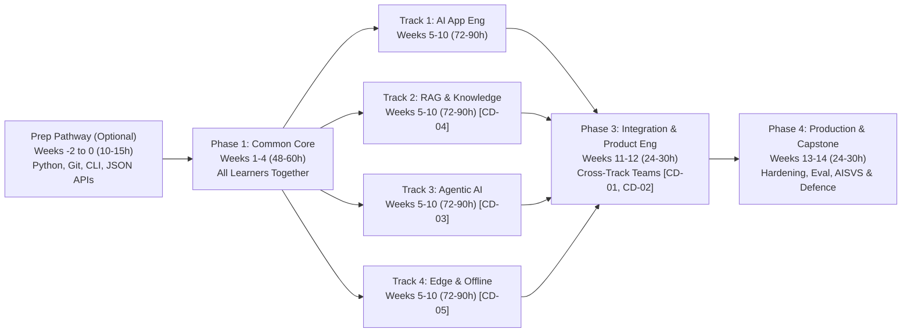

# MASTER PROGRAMME BLUEPRINT
## Asabiyyah Technologies Global Applied AI Engineering Masterclass

| Field | Value |
|---|---|
| Document ID | ASB-GOV-001 |
| Version | 0.2 Draft (Full Blueprint) |
| Status | Draft – pending management review |
| Owner (role) | Programme Director (TBC) |
| Last updated | 2026-11-16 |
| Parent document | [DECISION_REGISTER.md](DECISION_REGISTER.md) |
| Related decisions | AD-01–03, CD-01–05, PD-01–05, GD-01–02 |
| Stage of origin | Stage 0 (skeleton); Stage 2 (full development) |

> **Authority statement:** This document is the single programme-level source of truth for the Asabiyyah Technologies Global Applied AI Engineering Masterclass. All curricula, syllabi, lesson plans, assessments, handbooks, and operational documents must remain consistent with it. Confirmed management decisions (`AD-`, `CD-`, `PD-`) are binding; proposed recommendations (`PR-`) are explicitly labelled and awaiting final management sign-off.

---

## 1. Programme identity and overview

- **Programme Name:** Asabiyyah Technologies Global Applied AI Engineering Masterclass
- **Awarding / Delivering Organisation:** Asabiyyah Technologies Ltd
- **Programme Philosophy:** *One Foundation. Multiple Specialisations. Real-World AI Products.*
- **Duration & Mode:** 14 weeks, part-time (12–15 learner hours per week; 168–210 total hours), online-first live instructor-led international cohort with structured asynchronous and low-bandwidth resilience (AD-01, PD-03, PD-05).
- **Cohort Structure:** Up to 50 learners per cohort, supported by single-track mentor pods (1 mentor per 6–7 learners) during specialisation and cross-functional product teams (~5 teams of 10 learners) during integration and capstone delivery (PD-05, PR-04).
- **Overview:** The Masterclass is a rigorous professional engineering programme designed to train software-literate practitioners to design, build, test, evaluate, secure, document, and deploy production-grade AI systems. Unlike general AI literacy courses, prompt-engineering workshops, or purely theoretical machine learning degrees, every learner masters a shared software and AI systems foundation before specialising in one of four high-demand engineering tracks and shipping an evaluated, security-verified capstone product.

---

## 2. Vision and mission

- **Vision:** To establish a premier, globally competitive applied AI engineering standard originating from Nigeria and serving Africa and the global technical community—producing engineers capable of building reliable, secure, and locally adaptable AI products under real-world infrastructure constraints.
- **Mission:** To equip emerging and practising software engineers with demonstrable competencies in provider-independent AI application architecture, hybrid knowledge retrieval, protocol-standardised agentic workflows, offline-capable edge inference, quantitative evaluation, and security verification.

---

## 3. Programme philosophy

The programme rests on six non-negotiable engineering pillars:
1. **Systems Engineering over Prompt Tinkering:** AI models are treated as stochastic, non-deterministic software components that must be wrapped in deterministic schemas, automated tests, retries, telemetry, and access controls `[SRC-018]`.
2. **Concepts Before Frameworks:** Learners implement core mechanics (HTTP model calls, JSON schema validation, BM25 + vector rank fusion, ReAct execution loops, GGUF quantisation benchmarks) in clean Python before adopting high-level orchestration frameworks.
3. **Evaluation and Observability by Default (CD-01):** No AI system is considered complete without a baseline evaluation dataset, quantitative quality/latency/cost metrics, execution traces, and a documented failure analysis `[SRC-006, SRC-011, SRC-020]`.
4. **Proportionate Security and Regulatory Responsibility (CD-02):** Every system is threat-modelled and verified against applicable chapters of the **OWASP Artificial Intelligence Security Verification Standard (AISVS) 1.0** `[SRC-001]`, the **OWASP Top 10 for LLM Applications (2025)** `[SRC-002]`, and the **Nigeria Data Protection Act (NDPA) 2023** `[SRC-007]`.
5. **Open-Source, Provider-Independent, and Constraint-Resilient Design:** All core workflows run on modest CPU laptops using quantised open-weight models (`Ollama` / `llama.cpp` `GGUF`) or interchangeable free-tier APIs via a unified provider adapter—eliminating mandatory dependence on expensive GPUs or paid commercial subscriptions `[SRC-014, SRC-015]`.
6. **Demonstrated Competence over Certificate Collection:** Progression and completion require working GitHub repositories, reproducible benchmarks, evaluation and security reports, and an individual oral technical defence.

---

## 4. Industry and learner problem statement

1. **The Industry Gap:** Organisations across Nigeria, Africa, and global markets struggle to move AI prototypes into production. Hiring managers report a surplus of candidates who can run notebook tutorials or call a single vendor's chat API, but a critical shortage of engineers who can prevent hallucinations on proprietary documents, secure tool-calling agents against prompt injection, control token and latency costs, or deploy models where internet connectivity and cloud budgets are constrained.
2. **The Learner Gap:** Existing global courses either demand advanced academic mathematics without teaching software deployment, or lock learners into expensive commercial cloud ecosystems (requiring foreign credit cards, high bandwidth, and dedicated GPUs). Talented developers in resource-constrained environments need an accessible, engineering-grade pathway that turns real hardware and connectivity constraints into an architectural strength.

---

## 5. Target audience

The programme is designed for Nigerian and international participants (PD-05), including:
- Junior-to-mid-level software developers, backend/fullstack engineers, and data practitioners transitioning into Applied AI Engineering.
- Technical graduates and advanced self-taught programmers with foundational Python literacy seeking structured, portfolio-backed entry into AI systems roles.
- Engineering teams and technical founders building AI products for African and global markets where cost control, data sovereignty, and offline resilience matter.

---

## 6. Entry requirements and prerequisites

In accordance with **PD-04** and **PR-03 (R-01)**:

### 6.1 Mandatory Entry Baseline
- **Computer Literacy & OS Fluency:** Comfortable navigating filesystems, installing packages, and executing basic command-line operations.
- **Elementary Python Programming:** Demonstrable familiarity with variables, control flow (`if/else`, loops), data structures (`list`, `dict`, `set`), functions, basic file I/O, and reading tracebacks.
- **Mathematical Reasoning:** Comfort with basic algebra, percentages, averages, percentiles ($p_{50}, p_{95}$), and conceptual understanding of vectors/similarity (no advanced calculus or matrix proofs required for entry).
- **Prior AI Experience:** **Not required.** No prior ML, RAG, or agent engineering experience is assumed.

### 6.2 Hardware and Connectivity Baseline (PR-06 / R-05)
- **Minimum Hardware Specification:** 64-bit laptop (x86_64 or ARM64) with $\ge 4$ physical CPU cores, **8 GB RAM**, and **25 GB free SSD storage** (capable of running 1.5B–3B `Q4_K_M` GGUF models locally via `llama.cpp` / `Ollama`) `[SRC-014]`.
- **Recommended Hardware Specification:** 6–8+ physical cores, **16 GB+ RAM**, and **50 GB+ free SSD storage** (capable of running 7B–8B `Q4_K_M` models locally).
- **No GPU or Paid API Mandate:** Dedicated GPUs and paid commercial API subscriptions are **never mandatory** (PD-04). Learners on 8 GB machines are supported via compact 1.5B–3B local models and a standardised zero-cost cloud fallback adapter.

### 6.3 Optional 2-Week Preparatory Pathway (10–15 Hours, Self-Paced)
Applicants who need to consolidate their baseline before Week 1 complete the **Preparatory Pathway** (`02_COMMON_CORE/Preparatory_Pathway_Guide.md`), covering:
1. Python functions, virtual environments (`venv`/`uv`), modules, and type hints (`3.5 h`).
2. Command-line interface (CLI) and Git/GitHub fundamentals (`clone`, `branch`, `commit`, `push`, Pull Requests) (`3 h`).
3. JSON data handling, HTTP requests (`httpx`), and REST API fundamentals (`3.5 h`).
4. Tabular/text data handling and environment verification diagnostic (`3 h`).

---

## 7. Programme objectives

By delivering this programme, Asabiyyah Technologies Ltd aims to:
1. Establish a rigorous, reusable 4-week Common Core that brings all learners to a shared software, API, evaluation, and security baseline.
2. Develop deep specialist capability in one of four applied tracks: AI Application Engineering, RAG & Knowledge Engineering, Agentic AI Engineering, or Edge & Offline AI Engineering.
3. Embed quantitative AI evaluation, OpenTelemetry-aligned observability (CD-01), and OWASP AISVS 1.0 security verification (CD-02) as standard engineering habits across every track.
4. Enable cross-functional learner teams to integrate specialist components into complete, documented capstone products during Weeks 11–14.
5. Verify every graduate's individual competence through code ownership, empirical reports, and oral technical defence.

---

## 8. Graduate competency framework

Graduates are assessed across **nine Shared Core Competencies (`CC-01` to `CC-09`)** and **one Track Specialist Competency Cluster (`SC-AAE`, `SC-RAG`, `SC-AGT`, or `SC-EDG`)**.

### 8.1 Shared Core Competencies (All Learners)

| Code | Competency Domain | Measurable Engineering Capability | Target Bloom Level |
|---|---|---|---|
| **CC-01** | **Python & Software Packaging** | Write modular, type-annotated Python 3.11+ packages using reproducible virtual environments, clean interfaces, and configuration management. | Apply / Analyse |
| **CC-02** | **Git & Collaborative Engineering** | Use branching, atomic commits, pull requests, code reviews, and issue tracking for collaborative software delivery. | Apply |
| **CC-03** | **API & Backend Engineering** | Design, build, and test asynchronous REST and streaming (`SSE`) APIs using `FastAPI` and strict `Pydantic v2` validation `[SRC-018]`. | Apply / Create |
| **CC-04** | **AI/ML/LLM Technical Foundations** | Explain tokenisation, embeddings, attention/context windows, sampling parameters, quantisation, and model failure modes (confabulation, drift). | Understand / Analyse |
| **CC-05** | **Provider-Independent Model Integration** | Integrate local (`Ollama`/`llama.cpp`) and remote LLMs behind a unified adapter supporting structured outputs, tool calling, retries, and fallbacks. | Apply / Create |
| **CC-06** | **AI Evaluation & Observability (CD-01)** | Construct golden evaluation datasets, compute task quality metrics, instrument traces (`OpenTelemetry GenAI` / `Arize Phoenix`), track latency/cost, and write an **AI System Evaluation Report** `[SRC-006, SRC-020]`. | Evaluate |
| **CC-07** | **AI Security & Responsible Engineering (CD-02)** | Conduct threat modelling, apply **OWASP AISVS 1.0** controls (input validation, least privilege, prompt-injection defence, output handling) and **NDPA 2023** privacy principles `[SRC-001, SRC-007]`. | Analyse / Evaluate |
| **CC-08** | **Testing, Containerisation & Deployment** | Write unit, integration, and regression tests (`pytest`), containerise services (`Docker`), and deploy reproducible local or cloud builds. | Apply / Evaluate |
| **CC-09** | **Technical Documentation & Defence** | Produce architecture decision records (ADRs), runbooks, limitation statements, and defend design trade-offs orally. | Evaluate / Create |

### 8.2 Specialist Track Competency Clusters (Learners Master One Cluster)

| Cluster | Track | Specialist Engineering Capabilities |
|---|---|---|
| **SC-AAE** | **Track 1: AI Application Engineering** | Full-stack AI service architecture; streaming UX; multi-provider failover routing; semantic/exact caching; RBAC & rate limiting (LLM10); automated CI evaluation pipelines. |
| **SC-RAG** | **Track 2: RAG & Knowledge Engineering (CD-04)** | Document ingestion & structure-aware chunking; lexical (`BM25`) + dense (`sentence-transformers`) indexing; **Hybrid Retrieval via Reciprocal Rank Fusion (`RRF`)**; cross-encoder reranking; query transformation; metadata ACL filtering (AISVS C8); citation enforcement; **comparative retrieval benchmarking on a defined test dataset** `[SRC-008, SRC-009, SRC-011]`. |
| **SC-AGT** | **Track 3: Agentic AI Engineering (CD-03)** | Deterministic ReAct & state-graph orchestration (`LangGraph`); **practical Model Context Protocol (`MCP`) client and server implementation** (`Tools`, `Resources`, `Prompts`, discovery, OAuth 2.1 permissions, stateless `2026-07-28` awareness); human-in-the-loop approval gates; sandboxed execution (AISVS C9 & C10) `[SRC-001, SRC-005, SRC-019]`. |
| **SC-EDG** | **Track 4: Edge & Offline AI Engineering (CD-05)** | Open-weight model selection; `GGUF` quantisation (`Q4_K_M`, `Q5_K_M`, `Q8_0`); KV-cache & thread tuning in `llama.cpp` / `Ollama`; local embedded RAG; offline-first storage & conflict-resilient sync; **reproducible Edge AI Benchmark Report comparing $\ge 2$ configurations under identical host conditions** `[SRC-014, SRC-015]`. |

---

## 9. Programme learning outcomes (PLOs)

Upon successful completion of the 14-week programme, a graduate will be able to:
- **PLO-1 (Architecture & Implementation):** Design and implement a modular, provider-independent AI software component in typed Python with validated inputs/outputs, automated tests, and clean Git history.
- **PLO-2 (Specialist Mastery):** Deliver a working specialist system meeting all technical requirements of their chosen track (production AI web service, hybrid reranked RAG pipeline, MCP-enabled agentic system, or quantised offline-first edge service).
- **PLO-3 (Empirical Evaluation — CD-01):** Design a representative evaluation dataset, execute automated quality, latency, and cost evaluations, inspect execution traces to diagnose failure modes, and author a complete **AI System Evaluation Report**.
- **PLO-4 (Security & Governance — CD-02):** Identify architectural threats, implement mitigations mapped proportionately to **OWASP AISVS 1.0** and **NDPA 2023**, verify controls via adversarial test cases, and document residual risks without making false certification claims.
- **PLO-5 (Product Integration & Defence):** Collaborate within a cross-functional engineering team to integrate specialist subsystems into a deployable product and independently defend their technical architecture, metrics, and trade-offs.

---

## 10. Programme architecture

The 14-week baseline (AD-01) is structured into four sequential phases:

---

## 11. Common Core structure (Weeks 1–4)

All 50 learners complete the Common Core together (`02_COMMON_CORE/`):
- **Week 1 — Software Engineering Foundations for AI Systems:** Typed Python 3.11+, `Pydantic v2` data validation, `FastAPI` REST endpoints, `pytest`, Git branching/PR workflows, and reproducible environments `[SRC-018]`.
- **Week 2 — LLM Foundations & Provider-Independent Integration:** Transformer mechanics, tokenisation, context windows, sampling, local inference (`Ollama`) vs hosted APIs, building a unified **Model Provider Adapter**, structured JSON outputs, and basic tool calling `[SRC-015]`.
- **Week 3 — Application Architecture, Testing & Introductory Observability (CD-01):** Multi-layer service architecture, deterministic vs stochastic testing, golden evaluation datasets, baseline metrics, and local OpenTelemetry GenAI trace logging (`Arize Phoenix` / JSONL traces) `[SRC-006, SRC-020]`.
- **Week 4 — Foundational AI Security (CD-02), Responsible AI & Specialisation Readiness:** Threat modelling with OWASP Top 10 for LLMs (2025) and OWASP AISVS 1.0 (Chapters C2 & C7), prompt-injection defences, NDPA 2023 data privacy principles, Common Core mini-project submission, and the **Specialisation Readiness Assessment** `[SRC-001, SRC-002, SRC-007]`.

---

## 12. Four specialisation descriptions (Weeks 5–10)

Each learner selects and completes **one** six-week track (`72–90 hours`). Detailed curricula reside in `03_SPECIALISATION_TRACKS/`.

1. **Track 1 — AI Application Engineering (`AI_APPLICATION_ENGINEERING/`):**
   Covers multi-provider abstraction, streaming (`SSE`), resilient retries/fallbacks, semantic/exact caching, role-based authentication, token/cost rate limiting (LLM10), full-stack UI integration, and automated CI evaluation pipelines. *Specialist Deliverable:* Production-ready AI web service with provider failover and baseline evaluation suite.
2. **Track 2 — RAG & Knowledge Engineering (`RAG_KNOWLEDGE_ENGINEERING/` — CD-04):**
   Covers document parsing, structure-aware chunking, lexical search (`BM25`), dense embeddings (`sentence-transformers`), vector databases (`Qdrant`/`Chroma`), **Hybrid Retrieval via Reciprocal Rank Fusion (`RRF`)**, cross-encoder reranking, query transformation, metadata ACL filtering (AISVS C8), and source attribution. *Specialist Deliverable:* Grounded RAG system + **Comparative Retrieval Evaluation Report** benchmarking BM25, Dense, Hybrid+RRF, and Hybrid+RRF+Rerank on a defined test dataset `[SRC-008, SRC-009, SRC-011]`.
3. **Track 3 — Agentic AI Engineering (`AGENTIC_AI_ENGINEERING/` — CD-03):**
   Covers ReAct control loops, stateful graph orchestration (`LangGraph`), **practical Model Context Protocol (`MCP`) client and server implementation** (`Tools`, `Resources`, `Prompts`, discovery, OAuth 2.1 permissions, stateless `2026-07-28` patterns), human-in-the-loop approval gates, step budgets, and AISVS C9/C10 tool sandboxing. *Specialist Deliverable:* Bounded agentic workflow with a custom, tested **MCP server/client integration** `[SRC-001, SRC-005, SRC-019]`.
4. **Track 4 — Edge & Offline AI Engineering (`EDGE_OFFLINE_AI_ENGINEERING/` — CD-05):**
   Covers open-weight model selection, `GGUF` quantisation (`Q4_K_M`, `Q5_K_M`, `Q8_0`), CPU/hybrid inference tuning in `llama.cpp` and `Ollama`, memory/KV-cache optimisation, local embedded RAG, offline-first persistence, and intermittent-connectivity sync. *Specialist Deliverable:* Offline-capable local AI service + **Reproducible Edge AI Benchmark Report** comparing $\ge 2$ model configurations under identical host conditions `[SRC-014, SRC-015]`.

*(Note: **Machine Learning Engineering** is documented strictly as a future strategic concept note in `03_SPECIALISATION_TRACKS/FUTURE_ML_ENGINEERING/` per AD-03 and is not offered in initial delivery.)*

---

## 13. Integration and product engineering (Weeks 11–12)

To resolve the capstone compression risk (OQ-03, PR-05 / R-04), Weeks 11–12 bridge specialist projects into complete cross-functional products:
- **Week 11 — System Architecture, Contracts & Capstone Kickoff:** Learners form **5 cross-functional product teams of ~10** (combining Track 1, 2, 3, and 4 specialists). Teams define their capstone product problem, write API/MCP interface contracts, establish the golden evaluation dataset (CD-01), and draft the initial **AISVS 1.0 Threat Model & Control Matrix** (CD-02).
- **Week 12 — End-to-End Integration, Telemetry & Resilience:** Teams integrate backend/UI services (Track 1), knowledge grounding (Track 2), MCP tool workflows (Track 3), and local/edge fallback modes (Track 4) under unified OpenTelemetry tracing, automated integration tests, and containerised builds.

---

## 14. Capstone requirements (Weeks 13–14)

Every capstone project must submit a complete **Capstone Engineering Package** containing five mandatory artefacts:
1. **Working Source Repository (GitHub):** Reproducible build (`Docker` / lockfile), clean modular code, automated tests (`pytest`), and traceable individual commit history.
2. **AI System Evaluation Report (Mandatory — CD-01):**
   - Defined evaluation dataset ($\ge 30$ representative and adversarial test cases).
   - Quantitative baseline vs final metrics (task accuracy/faithfulness, schema validity rate, latency $p_{50}/p_{95}$, token/compute cost, and track-specific metrics such as retrieval `Recall@k`/`MRR@k` or edge `TTFT`/`tokens/sec`).
   - Trace inspection analysis, taxonomy of observed failure modes, and documented system limitations.
3. **OWASP AISVS 1.0 Security Verification Report (Mandatory — CD-02):**
   - Architecture threat model and data-flow diagram.
   - Proportionate control verification checklist mapped to **OWASP AISVS 1.0** core chapters (**C2** Input Validation, **C4** Infrastructure/Config, **C5** Access Control, **C6** Supply Chain, **C7** Output Control, **C12** Logging) plus applicable specialist chapters (**C8** Vector/RAG, **C9** Agentic, **C10** MCP, **C3** Model Lifecycle) `[SRC-001]`.
   - Adversarial test results (prompt injection, unauthorized tool invocation, cross-tenant retrieval, PII handling under NDPA 2023) and documented remediations.
   - **Mandatory Non-Certification Statement:** Explicit declaration that AISVS 1.0 is used as an internal engineering reference and does **not** constitute certification, accreditation, or an independent audit (CD-02).
4. **Architecture, Deployment & Operations Runbook:** System architecture diagram, configuration guide, local/offline execution instructions, and honest deployment status.
5. **Individual Oral Technical Defence (15 Minutes per Learner):** Live code walkthrough, evaluation/security questioning, and individual accountability check.

---

## 15. Delivery model

Per **PD-05** and **PR-04 (R-03)**:
- **Format:** Online-first, live instructor-led international cohort in English (maximum 50 learners in Cohort 1).
- **Two-Phase Cohort Grouping:**
  - *Weeks 1–4 (Common Core):* Whole-cohort plenary sessions (up to 50) supported by 8 mentor pods (6–7 learners per mentor).
  - *Weeks 5–10 (Specialisation):* Track-specific live instruction and **single-track mentor pods** (6–7 learners per mentor) for targeted code review.
  - *Weeks 11–14 (Integration & Capstone):* **Five cross-functional product teams of ~10 learners**, each co-supervised by assigned mentors, with strict individual module ownership.
- **Low-Bandwidth & Power Resilience (OQ-05):**
  - All live sessions are recorded and published in low-bandwidth formats (compressed video, audio-only track, and downloadable Markdown notes/code bundles).
  - Weekly **Pre-Session Download Manifests** allow learners to pull GGUF weights and packages once during off-peak connectivity and complete labs 100% offline.
  - Learners experiencing verified power/ISP outages complete an asynchronous check-in and GitHub lab submission without attendance penalty.
- **Platform Independence:** GitHub is used for code and assignment submissions (PD-05). Video conferencing, LMS, and community chat platforms remain modular and are selected in the operational stage.

---

## 16. Learning hours and workload validation

In strict compliance with **PD-03** (`12–15 hours/week`, `168–210 hours total`) and **OQ-13** (assignments are budgeted *inside* independent study and project hours, never added on top):

| Phase | Weeks | Live Instructor-Led (4 h/wk) | Guided Labs (3 h/wk) | Independent Study & Exercises (2–3 h/wk) | Project Dev & Assessment (3–5 h/wk) | Phase Total Hours |
|---|---|---|---|---|---|---|
| **Phase 1: Common Core** | Weeks 1–4 (4 wks) | 16 h | 12 h | 8–12 h | 12–20 h | **48–60 h** |
| **Phase 2: Specialisation (1 Track)** | Weeks 5–10 (6 wks) | 24 h | 18 h | 12–18 h | 18–30 h | **72–90 h** |
| **Phase 3: Integration & Product Eng.** | Weeks 11–12 (2 wks) | 8 h | 6 h | 4–6 h | 6–10 h | **24–30 h** |
| **Phase 4: Production & Capstone** | Weeks 13–14 (2 wks) | 8 h | 6 h | 4–6 h | 6–10 h | **24–30 h** |
| **Total (14-Week Programme)** | **14 Weeks** | **56 h** | **42 h** | **28–42 h** | **42–70 h** | **168–210 h** |
| *Optional Preparatory Pathway* | *Weeks -2 to 0* | *0 h (Self-paced)* | *0 h* | *10–15 h* | *0 h* | *(10–15 h pre-cohort)* |

**Workload Validation Findings:**
- Weekly load stays strictly within **12–15 hours**, realistic for working developers or final-year students.
- Starting capstone integration in Week 11 provides **48–60 total hours across Weeks 11–14** (`12–20 project hours` per learner, or `120–200 person-hours` across a 10-person team), making the capstone, evaluation report, and AISVS verification realistic without burnout.

---

## 17. Assessment architecture

Every competency (`CC-01..09`, `SC-*`) is verified through four progressive assessment gates:

| Gate | Timing | Weight | Required Evidence | Minimum Pass Standard |
|---|---|---|---|---|
| **Gate 1: Common Core & Readiness Assessment** | End of Week 4 | **20%** | Weekly lab repos (W1–W3) + W4 Mini AI App with baseline eval dataset & input/output safety checks + Readiness Practical Test. | $\ge 65\%$ overall; working code passing `pytest` suite. |
| **Gate 2: Specialisation Labs & Mid-Track Check** | Weeks 5–8 | **20%** | Weekly track lab submissions via GitHub PRs reviewed by track mentor. | At least 5 of 6 weekly labs accepted. |
| **Gate 3: Specialist Project & Mandatory Track Report** | End of Week 10 | **25%** | Working specialist system + Track-Mandatory Empirical Report (App Eval Suite / **CD-04 RAG Retrieval Comparison** / **CD-03 MCP Integration Test** / **CD-05 Edge AI Benchmark Report**). | $\ge 70\%$ rubric score; reproducible execution. |
| **Gate 4: Capstone Package & Individual Oral Defence** | End of Week 14 | **35%** | Integrated Product + **AI System Evaluation Report (CD-01)** + **AISVS 1.0 Security Report (CD-02)** + Individual Module Commits + **15-min Individual Oral Defence**. | $\ge 70\%$ on both team artefacts and individual oral defence. |

**Anti-Superficiality Rule:** Submissions consisting of copied tutorial notebooks, hardcoded mock outputs, missing evaluation datasets, or unverified security claims receive an automatic **Incomplete / Resubmit** grade.

---

## 18. Certification requirements

In accordance with Master Control Prompt §11 and **PR-01**:
- **Award Title:** *Certificate of Completion in Applied AI Engineering (with named Specialisation Track)* issued by **Asabiyyah Technologies Ltd**.
- **Integrity & Representation:** The certificate is an industry-oriented corporate training credential issued by Asabiyyah Technologies Ltd. It must **never** be described as a university degree, statutory professional licence, or externally accredited qualification unless formal external accreditation is subsequently obtained and verified.
- **Proposed Completion Criteria (PR-01 / OQ-10):**
  1. Pass all four assessment gates (overall weighted score $\ge 70\%$, with no gate below its minimum pass threshold).
  2. Submit all mandatory empirical artefacts: Track Specialist Deliverable (CD-03/04/05 as applicable), Capstone **AI System Evaluation Report (CD-01)**, and Capstone **OWASP AISVS 1.0 Security Verification Report (CD-02)**.
  3. Pass the individual Capstone Oral Technical Defence.
  4. Maintain $\ge 75\%$ engagement across live sessions or verified asynchronous low-bandwidth equivalents.

---

## 19. Quality assurance

1. **Pre-Cohort Technical Audit:** All lab starter repositories, GGUF model manifests, and `pytest` graders are tested on a baseline **8 GB RAM CPU-only environment** prior to cohort launch.
2. **Double-Marking & Calibration:** Gate 3 (Specialist Project) and Gate 4 (Capstone & Oral Defence) use criterion-referenced rubrics (`04_ASSESSMENT/`), with a 20% sample cross-moderated by the Programme Director.
3. **Bi-Annual Curriculum Currency Review:** Because standards such as MCP (`2026-07-28`) and OpenTelemetry GenAI semantic conventions evolve rapidly `[SRC-005, SRC-006]`, tool versions and specification references are reviewed before each cohort against `10_RESEARCH_AND_BENCHMARKING/Source_Register.md`.

---

## 20. Programme governance

- **Source of Truth Hierarchy:** `DECISION_REGISTER.md` $\rightarrow$ `MASTER_PROGRAMME_BLUEPRINT.md` $\rightarrow$ Track Curricula & Syllabi (`02_`, `03_`) $\rightarrow$ Assessment & Operations (`04_`–`09_`) $\rightarrow$ Derived Publications (`11_`).
- **Change Control:** Any proposed alteration to the 14-week duration, weekly hours, four active tracks, or five approved curriculum decisions (`CD-01..05`) requires a documented justification and explicit management approval in `DECISION_REGISTER.md`.
- **Policies Flagged for Legal Review:** Learner Intellectual Property (PR-02: default learner ownership of project code with non-exclusive showcase licence), Data Protection & Recording Consent under **NDPA 2023** `[SRC-007]` and international equivalents (OQ-09), Safeguarding, and Disciplinary Appeals (`09_ADMINISTRATION/`) must undergo qualified legal review prior to public enrolment.

---

## 21. Technology and infrastructure philosophy

1. **Local-First, Cloud-Compatible:** Every learner environment is built around Python 3.11+, `FastAPI`, `Pydantic v2`, `pytest`, `SQLite`/`Qdrant` local storage, and `Ollama`/`llama.cpp` running quantised open-weight models (`Qwen2.5-1.5B/3B`, `Llama-3.2-3B`, `bge-small-en-v1.5`) `[SRC-014, SRC-015, SRC-016, SRC-022]`.
2. **Interchangeable Provider Adapter:** Where hosted inference is used (e.g., for 70B model comparisons or on 8 GB laptops), calls pass through a standard adapter supporting free-tier OpenAI-compatible endpoints without changing application logic.
3. **Minimal Framework Footprint:** Across the entire programme, learners master raw Python control flows first, using only justified open-source libraries: `FastAPI`/`Pydantic` (web/schemas), `sentence-transformers` + `rank-bm25` + `Qdrant` (RAG), `LangGraph` + `mcp` Python SDK (Agents), `llama.cpp`/`Ollama` (Edge), and `Arize Phoenix` / `Promptfoo` / `RAGAS` (Eval & Observability).

---

## 22. Programme limitations and future expansion

### 22.1 Explicit Scope Limitations
- This programme does **not** train foundation models from scratch, teach deep theoretical CUDA kernel programming, or certify systems as independently security-audited (CD-02).
- It does **not** guarantee employment, salary outcomes, or third-party institutional accreditation.

### 22.2 Future Specialisation Expansion: Machine Learning Engineering (AD-03)
- **Status:** *Future Expansion Only — Not an Active Initial Track.*
- A strategic concept note is maintained in `03_SPECIALISATION_TRACKS/FUTURE_ML_ENGINEERING/ML_Engineering_Concept_Note.md` covering supervised/unsupervised learning pipelines, parameter-efficient fine-tuning (`LoRA`/`QLoRA`), experiment tracking, and model registry operations for potential launch in a later cohort once GPU/compute partnerships are established.

---

## Change log

| Version | Date | Change |
|---|---|---|
| 0.1 | 2026-11-16 | Skeleton created in Stage 0. |
| 0.2 | 2026-11-16 | Full 22-section Master Programme Blueprint completed in Stage 2 incorporating Stage 1 verified findings. |
